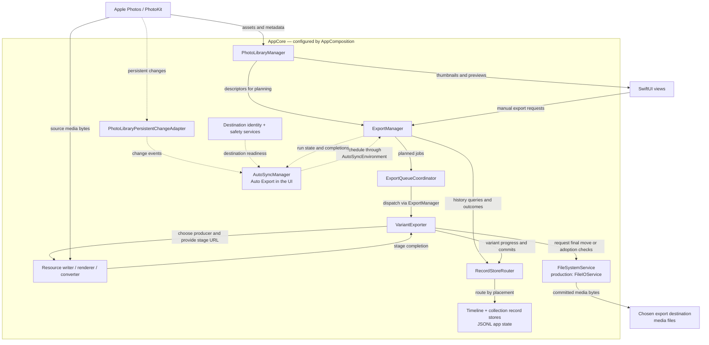

# Architecture Conventions

## Do you need this doc?

Read this before changing the export pipeline, record stores, placement/variant
models, cancellation ownership, AutoSync publications, or collaborator boundaries.
Start with the composition and role map to find the relevant owner, then read the
contracts and extension recipes that apply to your change.

A typo, copy correction, website-only edit or test that leaves production behavior
unchanged does not require reviewing every pipeline contract.

This is the contributor-facing source for composition, module responsibilities,
data flow and architecture contracts. Build/test commands and PR workflow live in
[`CONTRIBUTING.md`](../../CONTRIBUTING.md). Auto Export's dispatch, debounce, retry
and safety rules live in [`auto-export-behavior.md`](auto-export-behavior.md), and
disk formats live in [`persistence-store.md`](persistence-store.md). Archived plans
are decision records; use the living references for current requirements.

## The architecture in one paragraph

`ExportManager` is the public export façade over focused collaborators. SwiftUI
views request work and render observed state; the manager coordinates runs, the
queue serializes jobs, and per-variant producers stage bytes before a final commit.
Record stores track each placement's progress independently of files on the
chosen destination. AutoSync, the code name for the **Auto Export** UI feature,
requests work through the same façade.

## App composition and data flow

[`AppEntry`](../../photo-export/App/AppEntry.swift) starts `PhotoExportApp`, or the
empty `TestHostApp` under hosted tests. [`PhotoExportApp`](../../photo-export/App/photo_exportApp.swift)
builds one [`AppCore`](../../photo-export/App/AppCore.swift) from
[`AppComposition.forLaunch(arguments:)`](../../photo-export/App/AppComposition.swift)
and retains its remaining `ObservableObject` services with `@StateObject`.
The core owns the `@Observable` `PhotoLibraryManager`, `ExportManager`, `LoginItemController`,
`WhatsNewState` and both record stores;
`ExportManager` owns `ExportProgressState`. These objects reach views through
`.environment(_:)` without additional app-level wrappers. `MainWindowRoot` reads the timeline
store's history readiness in its body and passes that value through `ContentView` to
the active child; `LibraryRootView` reads collection readiness only when collections are visible.
See the [Observation migration recipe](observation-migration-recipe.md) for publisher delivery
and observation ownership contracts.

`AppComposition` selects production or screenshot services and supplies preferences,
app-state roots, Photos access, persistent changes, the resource writer, filesystem,
clock and login-item service. `AppCore` assembles the object graph from those inputs.
Tests supply isolated preferences and roots through `TestScratch`; see the
[test-scratch guard](../../scripts/README.md).

Every scene root receives the same objects, screenshot values and default
`@AppStorage` suite through `photoExportEnvironment(_:)` in `AppCore.swift`. Add a
new environment dependency there and update the hosted composition tests.

The main window's `.task` calls `AppCore.start()` once for the whole core. Startup
begins Photos observation after rendering, attaches the lifecycle coordinator to
configure destination history, attaches AutoSync before starting its change source,
and attaches destination safety monitoring. Additional windows do not repeat the
startup catch-up. Screenshot mode supplies a synthetic library and skips AutoSync
wiring; hosted tests build their own objects without launching production startup.

The main data paths are:

1. Photos → `PhotoLibraryManager` → app-owned descriptors for views and export planning.
   Thumbnail caching and progressive grid loading stay behind the library service. At job
   execution, the injected `PhotoKitReading` reader refreshes one descriptor/resource snapshot
   on a serial utility owner. Framework objects stay with that private per-job owner until
   physical writes finish and the job closes; only value metadata and an opaque writer carrying
   the session identity and owner cross awaits. Cancellation, destination and history ownership
   are checked before those values can authorize export IO.
   Shipping composition selects `ProductionPhotoKitReader`, and screenshot composition selects
   `ScreenshotPhotoKitReader` backed by the same curated library as the UI. Public resource UTIs
   identify the original format. The optional resource-local `fileSize` KVC read preserves
   known-size interrupted-file verification; its undocumented thread safety remains an explicit
   limitation, with access confined to the serial resource owner.
2. A manual action or AutoSync run → `ExportManager` → job planning and
   `ExportQueueCoordinator` → `VariantExporter`. Resource, render and conversion
   producers write an attempt-owned stage through the injected service seams.
3. `FinalNamePlanner` and the destination resolver choose names; `FileIOService`
   commits staged bytes to the destination. The
   [final commit contract](#final-file-commit-boundary) defines collision handling,
   identical-file adoption and filesystem-specific limits.
4. `RecordStoreRouter` sends per-variant outcomes to the timeline or collection
   store. Both persist through `JSONLRecordFile`; records support future skips,
   retry decisions and UI progress.
5. Persistent Photos changes → `PhotoLibraryPersistentChangeAdapter` → AutoSync's
   reducer/effect runner → the export façade. Destination identity, safety,
   scope settings, import activity and run publications gate that work through
   `AutoSyncEnvironment`; see the [behavior reference](auto-export-behavior.md).

### Object and data-flow diagram

`AppCore` assembles the services below from `AppComposition`. Solid arrows show
calls or data flow; arrows labeled **media bytes** trace exported photo/video bytes.
Preview images reach the views separately. Dotted arrows show observation,
scheduling or safety inputs.



The producer node represents the injected `AssetResourceWriter`, `MediaRenderer`
and `ImageConverter` seams, backed by their production implementations. They write
directly to the supplied stage URLs and signal completion; `VariantExporter` then
uses `FileSystemService` for adoption checks or the final move. The production
implementation is `FileIOService`. History is local app state under
`AppComposition.appStateRoot`, **outside** the selected media export destination.
AutoSync uses the same export pipeline as a manual action.

The destination/safety node groups `ExportDestinationManager`,
`DestinationSafetyMonitor` and `DestinationSnapshotAdapter`; their readiness
snapshot reaches AutoSync through `AutoSyncEnvironment`. The environment also
supplies scope settings, import activity and persistent AutoSync stores. Those
inputs are omitted from the diagram to keep the main path readable; their
contracts remain in the [Auto Export reference](auto-export-behavior.md).

## Glossary

- **Asset:** one item in Photos. Its `PHAsset.localIdentifier` identifies the item
  for queries, queue jobs and export records; a filename is not an asset identity.
- **Placement:** an export target within a destination: a timeline month,
  Favorites, a user album or a shared album. [`ExportPlacement`](../../photo-export/Models/ExportPlacement.swift)
  carries its kind, stable placement id and relative folder path. One asset can
  have separate export history in several placements.
- **Variant:** one concrete file version for an asset, such as original, edited,
  or a Live Photo's original/edited paired video. [`ExportVariant`](../../photo-export/Models/ExportVariant.swift)
  is distinct from the user's version-selection setting, which determines which
  variants a job requires.
- **Scope:** the set of Photos items a query or automatic export covers.
  `PhotoFetchScope` describes a Photos query; `LibrarySelection` describes the UI
  selection. Both live in [`LibrarySelection.swift`](../../photo-export/Models/LibrarySelection.swift).
  [`AutoExportLibraryScope`](../../photo-export/Models/AutoExportLibraryScope.swift)
  configures Timeline, Favorites, all user albums or all shared albums. A scope
  is not a destination path or a variant.
- **Seam:** an explicit boundary between components, usually a narrow protocol
  allowing a test fake. Here the **cancellation seam** is the queue's generation
  checks, and the **AutoSync seam** is the synchronous state/publication contract
  AutoSync observes. See [cross-cutting contracts](#cross-cutting-contracts).
- **Host:** a narrow protocol through which an extracted collaborator calls back
  to `ExportManager` for required state changes or dependencies. The collaborator
  keeps a weak host reference; cancellation goes directly through the queue.
  See [the Host pattern](#extracting-a-new-collaborator-from-exportmanager).
- **Stable logical destination id:** the persisted identity `ExportDestinationManager`
  owns for a chosen folder. It keys both export history and per-destination
  AutoSync state, surviving remount/path drift when the bookmark still resolves
  to the same folder. See [destination identity](#destination-identity).
- **Fingerprint:** current volume/path evidence about a destination. It informs
  safety confidence and may change after a remount; it never keys per-destination
  stores. It is distinct from the stable logical destination id.
- **AutoSync / Auto Export:** AutoSync is the internal type/module name; **Auto Export**
  is the name shown in the app. `AutoSyncManager` schedules work through
  `ExportManager`, with the reducer and injected environment controlling effects.
  See [Auto Export behavior](auto-export-behavior.md).
- **Export history / record stores:** local metadata recording variant outcomes
  and filenames for each destination and placement. The timeline store is
  asset-keyed; the collection store is placement-and-asset-keyed. History enables
  skipping completed work and rebuilding tracking through Import Existing Backup;
  it is separate from exported media. See [persistence](persistence-store.md).

## Module responsibilities

The role map names representative owners, not every type. Follow the source
links for the current implementation and complete file inventory.

- **[`App/`](../../photo-export/App/):** entry point, `AppCore` / `AppComposition`,
  lifecycle coordination, login items, diagnostics and What's New state.
- **[`PhotoLibrary/`](../../photo-export/PhotoLibrary/):** `PhotoLibraryManager` owns
  authorization, asset queries and image loading; `CollectionCountCache` shares
  concurrent count fetches; `PhotoLibraryPersistentChangeAdapter` exposes
  persistent changes. `ScreenshotPhotoLibraryService` is a peer protocol
  implementation providing curated synthetic assets.
- **[`Export/`](../../photo-export/Export/):** the façade, queue, variant writer and
  import coordinator, plus export planning, resource selection, naming, backup
  scanning and physical producer implementations.
- **[`Destination/`](../../photo-export/Destination/):** `ExportDestinationManager`
  owns bookmarks and stable destination identity; safety monitoring and snapshot
  adaptation feed AutoSync. `ExportDestinationResolver` allocates paths and stems.
- **[`Records/`](../../photo-export/Records/):** timeline and collection stores,
  JSONL persistence, placement routing, completion policy, filename claims and
  reconciliation. `FinalCommitContext` tracks transient final-file ownership.
- **[`AutoSync/`](../../photo-export/AutoSync/):** `AutoSyncManager` runs effects for
  the pure `AutoSyncReducer`; `AutoSyncEnvironment` supplies its seams, with
  file-backed dirty/retry/run/token stores under `Stores/`.
- **[`Protocols/`](../../photo-export/Protocols/):** injected boundaries for Photos,
  resources, rendering/conversion, filesystem and persistence operations, destination
  state, login items and AutoSync services. Add a narrow seam here when a new
  external operation needs a fake. This directory is the protocol inventory.
- **[`Models/`](../../photo-export/Models/):** app-owned descriptors, selections,
  placements, variants, records and run values. Keep pure rules in plain value types.
- **[`Views/`](../../photo-export/Views/) and [`ViewModels/`](../../photo-export/ViewModels/):**
  UI grouped by feature; `MonthViewModel` handles cancellation-aware progressive
  loading and in-place refresh for timeline and collection scopes.
- **[`Helpers/`](../../photo-export/Helpers/):** small pure utilities. Bundle resources,
  supporting files and the asset catalog remain in their corresponding folders.

### Export and record owners

- `ExportManager` owns run lifecycle, click-time setting capture and AutoSync-facing
  publications. `runExport(context:)` is awaitable; UI actions use the
  [canonical `start*` shape](#canonical-start-entry-point-shape).
- `ExportQueueCoordinator` owns pending jobs, counters, pause/resume/cancel, the
  sequential drain and generation cancellation. `VariantExporter` and
  `ImportCoordinator` reference it directly for that seam; their narrow Host
  callbacks reach the façade for UI state and dependency forwarding.
- `VariantExporter` selects a producer, stages or reuses bytes, commits the final
  file and records each variant outcome. `ResourceSelection` owns edited-producer
  dispatch; `ExportFilenamePolicy` owns `_orig` naming; `CollectionPathComponentPolicy` sanitizes
  collection path components; `ExportPlacementResolver` maps library selections
  to placements. `FinalNamePlanner` plans the final name after staging.
- `ImportCoordinator` runs backup scan, matching, bulk history adoption and
  reconciliation. `BackupScanner` handles timeline files and its `+Collections`
  extension handles collection trees; `CollectionBackupPlanner` selects which
  existing folders current collections adopt.
- `ExportRecordStore` tracks timeline assets by local identifier.
  `CollectionExportRecordStore` tracks Favorites, user albums and shared albums
  by `(placementId, assetId)`. Both reconfigure for the stable destination id and
  load history off the main actor while `.loading`.
- `RecordStoreRouter` is the single dispatch point for reads, writes, cleanup and
  reuse-source probes. `ExportCompletionPolicy` owns completion and edited-fallback
  checks; required sets come from the `requiredVariants` free function in
  [`ExportVariant.swift`](../../photo-export/Models/ExportVariant.swift). Keep those
  rules out of the façade.

### UI routing

[`ContentView.swift`](../../photo-export/ContentView.swift) routes authorization,
onboarding and library states. `LibraryRootView` hosts the split view. Timeline and
collection sidebars normalize multi-selection through their bucket types; the
focused year shows a summary, while months and collections show grids sharing
`MonthViewModel`. `ThumbnailView` and `AssetDetailView` own previews;
`ExportToolbarView` exposes actions and progress. `RecordStoreAlertHost` presents
history recovery for either store, and `ImportView` presents import progress/results.
See [`Views/`](../../photo-export/Views/) for the feature-specific views.

## Design rationale

- **Separate timeline and collection stores:** timeline records are asset-keyed,
  whereas collection records are placement-and-asset-keyed. Separate files preserve
  existing timeline history without a schema migration and isolate corruption.
  A shared record protocol would obscure those different APIs; `RecordStoreRouter`
  centralizes the actual dispatch instead.
- **Separate UI selection and Photos query:** `LibrarySelection` models what the
  user is looking at; `PhotoFetchScope` models what the library fetches. Keeping
  that boundary permits UI-only states without pretending they are Photos queries.
- **Main-actor persistence primitive:** both observable stores already call
  `JSONLRecordFile` from the main actor. Making it another actor would add hops
  without protecting new concurrent access. Its nonisolated I/O helpers run off
  the main actor; see [the isolation policy](#2-actor-isolation-policy).
- **In-place library refresh:** broad library revisions refresh descriptors and
  counts, while per-asset content revisions drive preview replacement. Restarting
  a visible grid load on every library edit used to blank it and lose user state.
  Preserve selection and reject superseded results; the full rules are under
  [preview content ownership](#preview-content-ownership), with the refresh
  implementation in [`MonthViewModel`](../../photo-export/ViewModels/MonthViewModel.swift).
- **Stable destination identity:** the stable id survives bookmark resolution and
  remount drift; the fingerprint only informs safety confidence. Recomputing store
  keys from a path can reopen empty history and duplicate exports. The complete
  rules are under [destination identity](#destination-identity).
- **Edited-video rendering:** PhotoKit does not expose the edited video as a static
  resource, so `ProductionMediaRenderer` uses `requestExportSession` and
  `AVAssetExportSession`. `ResourceSelection.selectEditedProducer` centralizes
  resource/render/HEIC-conversion/none dispatch so callers do not scatter media
  kind conditionals throughout the pipeline.

## Cross-cutting contracts

These three contracts bind every collaborator. Break one and you break either the AutoSync seam, cancellation safety, or the threading model.

### 1. Cancellation contract

**Storage**: `var generation: Int` lives on `ExportQueueCoordinator` (see [`ExportQueueCoordinator.swift`](../../photo-export/Export/ExportQueueCoordinator.swift) — search for `private(set) var generation`). `ExportManager` exposes a computed `var generation: Int { queueCoordinator.generation }` forwarder for test reads and in-module convenience.

**Helpers** (signature excerpt from `ExportQueueCoordinator`; `ExportManager` forwards dispatcher calls):

```swift
func isCurrent(_ gen: Int) -> Bool
func throwIfCancelledOrStale(_ gen: Int) throws
func bumpGeneration()
```

**Rule**: every async task that mutates state captures `let gen = generation` *synchronously* before the first `await`, then uses `[weak self]` + `guard self.isCurrent(gen) else { return }` at every checkpoint. Throwing paths use `try throwIfCancelledOrStale(gen)`.

**Which methods bump generation** (and so cancel anything running under the old gen):

- `cancelAndClear()` (on `ExportManager`, via `queueCoordinator.bumpGeneration()`)
- `interruptForDestinationUnavailable()` (same path)
- `supersedeForManualRun()` (same path)
- `cancelAutoSyncRun()` (same path; only while an AutoSync-sourced run is active). `AutoSyncManager.setEnabled(false)` calls it after the reducer is disabled, so turning Auto Export off stops the automatic run in progress; manual exports keep running.
- `cancelImport()` (on `ImportCoordinator`, via the injected `queueCoordinator` reference)
- Destination or history-save failure teardown from `performExport` (through the same manager teardown helper)

**Which method does NOT bump generation**:

- `clearPending()` — drops queued jobs only. In-flight work that started before `clearPending` keeps its `gen` and finishes normally. If you need to cancel mid-flight, call `cancelAndClear` instead.

**Collaborator seam**: `VariantExporter` and `ImportCoordinator` hold a direct (weak) reference to `ExportQueueCoordinator` for the cancellation helpers; their `Host` protocols no longer carry `isCurrent`, `throwIfCancelledOrStale`, `generation`, or `bumpGeneration` (issue #67 item 2 landed in May 2026). The coordinator's own dispatch loop reads its own `generation` / `isCurrent` directly. New collaborators that need the seam should inject `ExportQueueCoordinator` the same way, not route through `Host`.

### Preview content ownership

Thumbnail and detail tasks use asset ID plus the existing
`PhotoLibraryManager.thumbnailContentRevision(for:)` value, not broad `libraryRevision`.
Known content edits invalidate only affected IDs; unknown changes and bounded-tracking overflow
use the existing global fallback. The query registers a shared content counter, so an edit may
reevaluate each cell once; only a changed per-asset task identity starts a replacement decode.
Placement/history changes do not change preview identity.
The detail loader checks its captured revision predicate before installing a request and before
publishing success or error, in addition to UUID and Task cancellation guards. This rejects a
superseded response even before SwiftUI starts the replacement task. Same-asset replacement
retains the displayed image while loading; other selected IDs hide prior content immediately.
A current failure clears retained bytes to expose the existing error message. Grid descriptor
refresh remains owned by `MonthViewModel` and its parent selection binding. The model emits a
payloadless selection update synchronously after each owned visible batch or successful complete
snapshot. Grids derive the current descriptor from the live binding inside `onReceive`; they do
not queue binding writes through `onChange`/task identities. A completed snapshot proves absence
(first survivor or empty clears); unfinished enumeration preserves a choice still awaiting its
batch. Failed or obsolete refreshes do not emit a selection update.

### Import outcome ownership

`ImportCoordinator` owns transient `isImporting`, `importStage` and `importError`; the manager
mirrors them with synchronous sinks. Writable `importResult` remains a Host callback. A private
operation UUID owns UI outcomes separately from the queue generation: destination teardown may
invalidate the generation without cancelling the task. Progress/results/errors require current
UUID and generation; deferred stale cleanup may settle only its own UUID. Cancel invalidates UUID
before clearing state. Publish error/report/stage before setting activity false, and perform no
old-operation state writes after that publication. Scope release still waits for physical work.
Cancelling the import reaches the detached backup scan, which stops before its next directory
entry, file entry or `videos/` check.
Retry preserves timeline-only compatibility when the collection store is unconfigured, but waits
for recovery if either history store has failed. Scanner matching error propagation is unchanged.
An import started while either history is `.loading` (right after a destination change) claims
`isImporting` at once, so exports stay held, then waits for both stores to settle and rechecks
its UUID, generation and both stores' destination; a destination change abandons it. A timeline
history that is then not `.ready` ends the import through `finishOwnedImport` with a reason:
for a "Same Folder" check, the "couldn't check" message its synchronous refusal gives;
otherwise, that the export history isn't available. A history that is settled but not ready
still refuses synchronously.

### Final file commit boundary

Every byte-producing attempt (PhotoKit resource, render, HEIC conversion or reuse)
owns a short hidden UUID stage adjacent to its final destination. HEIC source bytes
use a unique input in app-owned local temporary storage; capacity checks and cleanup belong
there, while the JPEG stage stays at the destination. Launch sweeps only recognized local
input directories whose process owner is proven dead, preserving live owners and links.
Physical producers may outlive
Task cancellation: cleanup removes only their own stages, producer errors recheck
generation before reaching outcome recording, and HEIC materialization rechecks before
starting conversion. Callers also recheck after exporter awaits and before failure/fallback
mutations. The legacy fixed `.tmp` sweep remains for older builds; unique crash leftovers
are not automatically scavenged. Staging paths never determine final filenames.

The final move never replaces an existing file. `FileIOService.moveItemAtomically` refuses an
existing destination with `Export` code 2 ("Destination already exists"), which classifies as a
destination collision with the `Export:2` error signature (persisted in retry state for Auto
Export runs). The existing bytes stay. A paired slot's variant fails; any other slot plans its name
again (see [Choosing the final name](#choosing-the-final-name)).
It creates the destination folder, then asks the folder's volume whether it advertises
`VOL_CAP_INT_RENAME_EXCL` (`getattrlist` `ATTR_VOL_CAPABILITIES`, asked on every commit):

- **Advertised:** one `renamex_np(stage, final, RENAME_EXCL)` with no pre-check, so the refusal
  and the move are a single step. `EEXIST` becomes `Export:2`. `ENOTSUP` or `ENOSYS` means the
  volume advertised the flag but rejected it: a failed rename leaves the stage in place, so the
  commit logs a notice (once per volume per launch) and takes the check-then-move path below.
  Any other errno is logged and thrown as `NSPOSIXErrorDomain` with that code, so `ENOSPC`,
  `EACCES`/`EPERM`/`EROFS` and the unreachable-destination errnos (`ENOTCONN`, `ETIMEDOUT`,
  `ESTALE`, `EHOSTDOWN`, `EHOSTUNREACH`, `ENETDOWN`, `ENETUNREACH`, `ENXIO`) keep their
  categories. `ENOENT` and `EIO` are `unknown`, because either can come from somewhere other
  than a lost destination, and `EXDEV` stays `unknown` (the stage always shares the final
  file's folder).
- **Not advertised:** check, then `FileManager.moveItem`, unchanged. `moveItem` refuses an
  existing file itself, and that refusal is reported as `Export:2` too. Neither check is one
  step with the rename, so on these volumes a file written in the moment between `moveItem`'s
  own check and its rename can still be replaced. This window is the documented limit for
  ExFAT, FAT and any network share that does not advertise the bit.

Before the commit used `renamex_np`, those failures came from `FileManager.moveItem` as
`NSCocoaErrorDomain` errors. On capable volumes they now carry `NSPOSIXErrorDomain:<errno>`
signatures, so an Auto Export retry count for a recurring non-collision failure starts again
once after upgrading, and users see Foundation's POSIX message (for example "The operation
couldn’t be completed. No space left on device") instead of the Cocoa one. Collisions keep
`Export:2` on both paths.

The capability is read from the volume rather than inferred from errno: on file systems that do
not advertise it, XNU emulates `RENAME_EXCL` with a lookup before the rename (racy in the same
way, and it answers `EEXIST` like the real flag), and ExFAT returns `ENOTSUP` even for a fresh
name. The `ENOTSUP`/`ENOSYS` fallback only covers a volume whose advertised bit turns out
wrong. No placeholder file is ever created at the final name.

[`scripts/probe-exclusive-rename.sh`](../../scripts/probe-exclusive-rename.sh) records the
behaviour on disk images, weekly and on dispatch, in the toolchain canary (`macos-15` and
`macos-26`). It fails if any volume replaces an existing file, if a volume that advertises the
bit does not rename a fresh name and refuse an existing one with `EEXIST`, or if APFS or HFS+
stops advertising it.

Results from a local Mac on macOS 26.6.2 (Apple silicon) and the canary's dispatch run
[39421950567](https://github.com/valtteriluomapareto/photo-export/actions/runs/39421950567):
the `macos-15` runner (macOS 15.7.9) and the `macos-26` runner (macOS 26.6.2) matched it on every
volume.

| Volume | `VOL_CAP_INT_RENAME_EXCL` | Exclusive rename, fresh name | Exclusive rename onto a file | Existing bytes | Commit path |
| --- | --- | --- | --- | --- | --- |
| APFS | yes | ok | `EEXIST` | intact | exclusive rename |
| HFS+ | yes | ok | `EEXIST` | intact | exclusive rename |
| ExFAT (FSKit on macOS 26) | no | `ENOTSUP` | `EEXIST` | intact | check, then move |
| MS-DOS FAT32 (FSKit on macOS 26) | no | ok (emulated) | `EEXIST` (emulated) | intact | check, then move |

The stage was kept after every refused rename.

SMB shares cannot be imaged, so they stay a manual check before a release that changes this
commit. Mount a share from a macOS server and one from a NAS (Samba) and record, per share:

1. `bash scripts/probe-exclusive-rename.sh --folder /Volumes/<share>`: the capability bit, both
   rename results and the existing bytes. It works in a new hidden subfolder and removes it.
   With the bit, exports take the exclusive path; without it, check-then-move.
2. Export one month to the share, quit the app, remove that destination's record folder (see
   [persistence-store.md](persistence-store.md)) and export the month again. Every existing
   file must stay byte-identical. Single files should be recorded against their identical
   copies; paired groups, and any name the share reports in another normalization, may add
   ` (1)` copies or report "Destination already exists". No file may ever be replaced.
3. During an export of a large month, copy a different file from another Mac to the final name
   of an item not yet exported. The copied file must survive, and that item must fail with
   "Destination already exists" or land under ` (1)`.
4. Disconnect the share during an export. The first item that fails as destination
   unavailable stops the run, and a manual export says the destination can't be reached.
   An `EIO` may still fail items as an unknown, retryable error until the unmount
   notification interrupts the run. There must never be a zero-byte or partial file at a
   final name (hidden `.photo-export-*.tmp` stages may remain).

#### Choosing the final name

The final name of a file written alone is chosen once its bytes are staged. A paired
original-side slot (`_orig`, or a still or motion file that shares a pre-allocated group
stem) has one fixed name, and an existing file there fails the variant as above.
`resolveSlot` also fails it, before staging, when a record other than this variant's own
names it (`Export:5`, "Paired original filename is recorded for another exported file"). The
file is checked first, so a name that both holds a file and is claimed keeps the on-disk
message. A verified interrupted file excuses only the file, never the claim. This matters on a
stem inherited from a completed record, which nothing allocates; the variant fails on every
run while the claim stands. Import Existing Backup clears a completed claim whose file was
deleted. A failed claim blocks the name until the claimant's retry lands at another name; if
the retry writes this name itself, the variant then fails with the on-disk message. The
asset's own other variants count too: a reverted Live Photo edit whose `.editedPairedVideo`
record names `IMG_0001.MOV`, with that file deleted, fails the `.originalPairedVideo` there,
which is accepted. A group stem
is allocated before staging (`allocatePairedGroupStem`, and `allocateUnusedOrigStem` for an
edited fallback) where every name of the group is empty and no other asset's record names it;
the asset's own records in the placement do not count, so a retry keeps its names. Every other
slot (a single original, an edit on an inherited or fresh stem) is walked in order, natural
name first, then ` (1)`, ` (2)`… (`FinalNamePlanner`, off the main actor through
`runDetached`, generation rechecked afterwards):

- **Nothing there** (`lstat` finds no entry) and no record other than this variant's own names
  it (see claims below): commit the stage there. A record whose file was deleted keeps its
  name until Import Existing Backup drops that record, so a different asset or variant never
  takes the name and the reconcile can still see the file is gone.
- **An existing file is adopted** instead of writing a copy when all of these hold: it is a
  regular file (a symbolic link is never followed) with one link, since a second hard link
  would give one file two names that different records could claim; its size is non-zero
  and equal to the stage's; no record other than this variant's own names it in that folder
  (see claims below); its bytes equal the stage's; and its folder stores it under a spelling
  of the candidate's name (`getattrlist` `ATTR_CMN_NAME`). The compare keeps one read handle open per file
  (the existing file's with `F_NOCACHE`), reads the head and the tail in 1 MiB pieces, then
  the rest in order in 8 MiB pieces, and stops at the first difference. Task cancellation is
  checked before every read; the run's generation, a main-actor hop, before the first and
  then once per 32 MiB. An open or read error on either file, or a stored name that cannot
  be read, passes the candidate over. No digests are stored or computed.
- **Anything else** (other bytes, another size, empty, a link, a folder, claimed): try the
  next suffix.

The variant is marked in progress under the provisional name (the first candidate with
nothing at it that no other record names, as before staging; `firstFreeURL(in:isClaimed:)`),
so an interrupted export never leaves a second record naming another record's file. It is
re-marked under the planned name whenever planning picks another. Planning reads claims
through main-actor hops while it compares, so before a planned adoption is marked the
exporter asks again synchronously on the main actor; a name claimed by then counts as a
collision. It asks again before marking a planned move too, with its own log line ("was
claimed after it was planned"). That check is defensive and untested: claims change only on
the main actor and exports run one at a time, so nothing can claim the name in between. The commit of an adopted file re-runs `lstat` and requires the same device, inode,
link count, size and modification time as when its bytes were compared; it then removes the stage, applies no
timestamps and acknowledges the file under its stored name (`getattrlist`
`ATTR_CMN_NAME`), which can differ from the resource's name in case or normalization. A
changed file, or `Export:2` from the exclusive rename, makes the commit report a collision
without acknowledging anything; the exporter plans again from the natural name, at most
`VariantExporter.maxCommitAttempts` (3) times, rechecking generation each time, before the
variant fails with `Export:2`. A paired slot fails at the first collision. The stage stays in
place across a re-plan.

Claims: each record store keeps, per folder (timeline month or collection placement, plus
the variant's subfolder), a count of the filenames its variant records name, case-folded
and in NFC. A claimed name is taken whether or not a file is at it: it is never adopted for
another asset or variant, and never written by one. Every status counts, including
in-progress, pending and failed, and so do the asset's other variants: an edit on an
inherited stem must not adopt, or write into, the name its own original is recorded under.
Only the variant being written is excluded, or, for a group stem, all of the asset's own
variants in the placement. An edited fallback's
`edited` record names no file, on every completion path. Each store prepares its complete claim index off main with the recovered records and counters. One installer advances the records epoch and installs those matching values; incremental mutations update that index in the same synchronous batch as the records. Empty/loading history has an empty ready index, so a first query never scans the library. Normal load, retained recovery, reset and parked-history restoration all use the installer. Production writers await store-owned maintenance admission, then recheck destination/load ownership before their bounded synchronous mutation. A live claim check and its in-progress mark share that admitted turn. Claim queries do not answer "claimed" while a store loads: the
resolver walks suffixes while a name is claimed, and only a stale job from the previous
destination can ask then, and its generation check drops the result. A timeline placement
without a year and month has no claim folder; an export of one fails at once (with an
`assertionFailure` in debug builds) rather than walking every suffix.

Known limits: only the folder the variant is being written to is searched, so an identical
file left in `videos/` (or outside it) by a layout change is not found. Paired groups and
`_orig` slots are allocated before staging and are never adopted. Neither is an image whose
paired video the same job writes next at its stem: adopting the image could find the video's
name taken and split the pair, so the image takes a free name and the video follows it.
Claims are keyed by placement id, so two placements whose folders are one folder on disk (for
example names that differ only by case on a volume that ignores case) do not see each other's
claims (#368). An edit on a newly allocated stem can
still land at ` (1)` when the asset's own failed original still names that stem's natural
name; the next run resolves it. A failed or interrupted record keeps its name reserved until
it is retried, including one for an asset since deleted from Photos; Import Existing Backup
drops only completed records whose file is missing. Histories where two records already name
one file are not repaired. Rendered video and
HEIC-to-JPEG output usually differ byte for byte from an earlier export, so they get a
suffix, which is safe. On a network volume that is case- or normalization-sensitive, a file
whose stored name differs from the resource's only in normalization is not found by
`lstat` and the export lands at ` (1)`. Adoptions are logged (`VariantExporter`, "Adopted
existing identical …"); they are not counted in the run summary or shown as Export Issues.

`VariantExporter` checks generation immediately before admitting the final atomic move.
After admission, a short-lived task owns the physical move or adoption check, timestamps and
record acknowledgement. The export that wrote a stage is its only owner and removes it when it
returns, once the commit task has finished; stage names are unique, so that removal can never
touch a replacement job's stage. A successful move or adoption is acknowledged to
its captured logical destination even if the run becomes stale. The acknowledgement carries the
committed name (`nil` when nothing was committed), and every completion path in both stores
records that name: the direct completion, the completion deferred behind a corrupt load, the
write into a parked destination's history, and the restore of a parked snapshot.
`RecordStoreRouter` captures that store's existing JSONL owner; each store parks its latest
snapshot only when switching away, merges the completed variant, and retains write failures
through the existing non-destructive persistence recovery path. A corrupt load keeps its alert
and bytes intact; only the known completion delta is deferred until a valid load or explicit
reset. Collection acknowledgements restore missing placement metadata without replacing newer
metadata. No persisted schema changes or crash-atomicity guarantee is implied.

A commit acknowledged while its destination is active and `.loading` is held, then lands as if
it had arrived just after the load:

- When the load finishes, it lands against the state the load ends in: recorded on a ready
  load (its write is flushed by the store's ordinary append path), deferred until the reset on
  a corrupt one, added to the restored parked history on an unreadable one.
- A load replaced by another configure of the same destination keeps it for the newest load;
  if that configure takes the retained-recovery exit instead, it lands in the retained history.
- When the store leaves the destination before the load finishes, it is written into that
  destination's parked history at once, on the IO queue after the discarded read, and flushed
  before the switch continues. A later load of the destination reads it; a write failure is
  retained for Retry like any parked commit's.
- A write failure retained while the destination loads parks only the commit's own snapshot,
  without copying the empty in-memory records or marking them unsaved; the finished load
  installs the parked history and goes to `.persistenceFailed`.

Queue teardown remains synchronous and does not discard this task. Replacement jobs await its
barrier before their initial record flush, history reads, or filename allocation, then recheck
generation and persistence health. Ordinary generation checks resume immediately afterwards, before additional variants,
fallback bookkeeping, or UI changes. Security-scoped access remains held by the original export
until the complete bounded commit finishes.

### 2. Actor isolation policy

Reuse-source filesystem copies run on an explicit utility Dispatch worker through the
Sendable filesystem seam. Cancellation waits for physical IO to finish before releasing
security-scoped access, then rejects stale success/errors before fallback or commit.
Each reuse attempt owns a short hidden adjacent staging file through fallback and the
existing no-overwrite move; late cleanup cannot remove a replacement attempt's temp.
Normal/error/cancel exits attempt to remove their stage. A process crash, unavailable
volume, or removal failure can leave a hidden unique stage; automatic scavenging is not
implemented. Legacy fixed
`.tmp` cleanup remains immediate. Queue identifier and render-activity cleanup must check
the owning generation before changing UI state.

| Type kind | Isolation | Examples |
| --- | --- | --- |
| `ObservableObject` with `@Published` state observed by SwiftUI | `@MainActor final class` | `ExportQueueCoordinator`, `ImportCoordinator`, `ExportDestinationManager` |
| `@Observable` state observed by SwiftUI | `@MainActor final class` | `ExportManager`, `ExportRecordStore`, `CollectionExportRecordStore` |
| Main-actor collaborator without `@Published` (mutates shared state from MainActor only) | `@MainActor final class` | `VariantExporter`, `RecordStoreRouter`, `JSONLRecordFile` |
| Main-actor composition wrapper — final, conforms to `PhotoLibraryService`, optionally wraps an injected service for curated screenshot content | `@MainActor final class` | `PhotoLibraryManager` (wraps `overrideService`), `ScreenshotPhotoLibraryService` (peer, no inheritance) |
| Pure helper / policy (value-typed, no I/O state) | plain `struct` or `enum`, `Sendable` where it crosses tasks | `ExportJobPlanner`, `ExportCompletionPolicy`, `ExportDestinationResolver`, `ExportFilenamePolicy`, `CollectionPathComponentPolicy`, `ExportPlacementResolver`, `ResourceSelection`, `BackupScanner`, `FileIOService`, `FinalNamePlanner`, `ProductionAssetResourceWriter`, `ProductionMediaRenderer` |
| Concurrent state holder | `actor` | `CollectionCountCache` |
| Heavy work that must hop off MainActor | `nonisolated async` selectively on protocol-conforming methods | `PhotoLibraryService` (selectively `nonisolated` count methods), `MediaRenderer`, `AssetResourceWriter`, `FileSystemService` |

Rules:

- Do **not** add `@MainActor` to pure helpers reflexively. If a type holds no state and crosses task boundaries, make it `Sendable` and leave the isolation off.
- Do **not** promote a collaborator to `actor` to "fix" concurrency unless you have a measurement showing main-actor contention. `@MainActor` is the established pattern because `@Published` + SwiftUI binding works there without `await` ceremony.
- Each `@MainActor final class` collaborator should carry a one-line comment at its top declaring its isolation. (Stops future contributors from silently making it `nonisolated`.)
- Await detached work through `runDetached(priority:operation:)` (`Helpers/RunDetached.swift`), not `Task.detached { … }.value`. Awaiting `.value` never cancels the detached task, so its own cancellation checks never fire. The helper forwards the caller's cancellation and still waits for the operation to finish.
- Record-store loads leave the main actor in one pipeline. `beginConfigure(for:)` runs the synchronous prologue (drains, parking, the destination switch, clears, and the nil and retained-recovery exits), publishes `.loading`, and reads the files (`JSONLRecordFile.readFiles`) on the store's serial IO queue at `.userInitiated` with enforced QoS, behind the previous destination's queued writes. `decode` and `prepare` run in a detached `.userInitiated` task, which skips them once a newer configure has started (a lock-protected generation). The result is installed in one main-actor turn after checking the ticket (configure generation and file); a stale result is discarded with a debug log line. Every state change goes through one funnel that resumes `waitUntilSettled()` callers whenever the state leaves `.loading`, including the nil exit, the retained exit and the blocking `configure(for:)`. A load replaced by another `beginConfigure(for:)` keeps the store `.loading`, so its waiters resume when the newest load settles. The drains stay: a configure while a load is still reading waits on the main actor for that read, not for its decode. `configure(for:)` remains the blocking composition of the same steps and publishes no `.loading`.
- Readers of a loading store see empty records. Auto Export's `runExport` fails fast as for any store that isn't `.ready`; manual export controls are disabled through `ManualExportAvailability` (the Month and Year summaries read "Loading export history…"); `DestinationSafetyMonitor` waits for both stores after its scan and rechecks its generation and the stores' destination; Import Existing Backup waits (§Import outcome ownership). The onboarding auto-skip, `DiagnosticReporter` (0 records) and retry pruning (nothing pruned) may read the empty history; that is harmless.

### 3. AutoSync seam preservation

**Invariant**: `ExportManager+AutoSyncConformance.swift` is a thin wire-up file — only `extension ExportManager: …Host {}` conformances and explanatory docstrings, no implementation bodies. New collaborators may add conformances, but the file must not carry method bodies. AutoSync reads the manager via the conformance file's declared protocols; if you need a new bit of state AutoSync should see, add it to the manager (or sink it from a coordinator onto the manager — see below), then expose it through the conformance.

**Publisher surface** (contextual excerpt from `ExportManager.swift`):

```swift
var exportRunStatePublisher: AnyPublisher<ExportRunState, Never> {
  Publishers.CombineLatest4(
    activeRunContextBridge.publisher, isRunningBridge.publisher,
    queueCountBridge.publisher, isEnqueueingAllBridge.publisher
  )
  .map { context, isRunning, queueCount, isEnqueueingAll in
    let manualFireAndForget =
      context == nil && (isRunning || queueCount > 0 || isEnqueueingAll)
    return ExportRunState(
      activeContext: context,
      isManualActive: context?.source == .manual || manualFireAndForget,
      isAutoSyncActive: context?.source == .autoSync
    )
  }
  .removeDuplicates()
  .eraseToAnyPublisher()
}
```

The `CombineLatest4` over `(activeRunContext, isRunning, queueCount, isEnqueueingAll)` is the AutoSync contract. Each is held in an `ObservableCombineBridge`, which delivers exactly as `@Published` does while views track the properties through Observation ([`observation-migration-recipe.md`](observation-migration-recipe.md) §The bridge). The `manualFireAndForget` branch makes toolbar exports (which never set `activeRunContext`) register as `isManualActive` — without it, AutoSync would attempt to start a background run while the toolbar queue was busy. `isEnqueueingAll` participates so the bulk-enqueue window (after the dispatcher flips it true but before the first job lands in `pendingJobs`) is observable as busy too (issue #67 item 4a). Adding new state to the quadruple is a deliberate, audited change — re-record the [`AutoSyncSeamCharacterizationTests`](../../photo-exportTests/AutoSyncSeamCharacterizationTests.swift) snapshots only after verifying the new emission sequence is correct.

**Mirror pattern** (contextual excerpts when a coordinator owns state that AutoSync observes through the manager):

```swift
// On the coordinator:
@Published private(set) var isRunning: Bool = false
@Published private(set) var queueCount: Int = 0

// On ExportManager.init, after collaborators are wired up. Each coordinator
// has its own cancellable set (`queueCancellables`, `importCancellables`) so
// a coordinator can be torn down or rewired independently.
queueCoordinator.$isRunning
  .sink { [weak self] in self?.isRunning = $0 }
  .store(in: &queueCancellables)
queueCoordinator.$queueCount
  .sink { [weak self] in self?.queueCount = $0 }
  .store(in: &queueCancellables)
```

Both objects are `@MainActor`. The coordinator's `@Published` delivery and the manager's bridge delivery and storage are synchronous, so the AutoSync `CombineLatest4` observes consistent state. The synchrony pin is [`ExportQueueStateSnapshotTests.teardownQueue_synchronouslyClearsManagerMirrors`](../../photo-exportTests/ExportQueueStateSnapshotTests.swift) — if you make a mirror async (`.receive(on:)`, `MainActor.run`, etc.) that test fails.

Unpublished queue contents stay owned by the coordinator. It compares the pending-job count,
processing flag, current task identity and placement counts around queue mutations, then calls
`Host.queueContentsDidChange()` once when that fingerprint changes. The manager increments
an Observation-only `queueMutationCounter`; all five queue read-throughs touch it before
returning the coordinator's values. This adds no `objectWillChange` publication and keeps
the mirrors above synchronous. A first dequeue changes the contents even while total queue
depth stays equal, so its readers do not depend on a depth notification.

### AutoSync dirty-work acknowledgement

`AutoSyncReducer` captures a `RunDirtyBoundary` (run context, stable destination ID, and scopes changed since start). The fan-out sends `exportRunStarted` before each scope's `await runExport`; synchronous `exportRunStateChanged` observations capture manual runs and never reset an existing boundary for the same run ID. Keep the boundary across the idle publication: the completion summary arrives afterward.

Every export-relevant Photos event invalidates the affected scopes, including repeated changes to the same asset, changes while full reconciliation is already pending, and collection-only changes for album scopes. Successful completion acknowledges only covered, selected scopes that have not changed since the matching run began. Unknown, failed, or destination-mismatched completions cannot clear pending work. The boundary is transient: the existing persisted dirty state remains authoritative after restart, so no persistence migration or counter is needed.

### AutoSync destination ownership

Each AutoSync fan-out captures the stable destination ID and a transient task identity.
Completion events carry the originating destination and are accepted only for the current
matching run boundary. Every destination identity change cancels the old fan-out and invalidates
its boundary. Returning to the same destination does not revive an abandoned run.

Task-handle and diagnostic-journal cleanup must verify ownership before clearing state.
An old task exiting after a replacement starts must leave the replacement's handle and journal intact.
These guards are transient; persisted run-summary, retry, and dirty-state formats stay unchanged.

### AutoSync retry lifecycle

Retry eligibility is per destination, placement, asset, and variant, decided by `RetryEntry.isEligibleForAutoSync(now:)` through `AutoSyncManager.isAutoSyncEligible`. A deadline decides when there is one. Without one, only `destinationUnavailable` is eligible: Auto Export runs only while the destination is available, so the next run is its retry and it never arms the retry timer. Other entries without a deadline wait for user action. Enqueue checks only missing variants; execution checks again immediately before each variant attempt, including an edited export's original fallback. Manual runs bypass automatic backoff. Keep the full required-variant set for filename pairing and completion policy even when only one variant is eligible.

The reducer schedules the earliest automatically retryable entry in enabled scopes. Firing consumes the exact entry in transient state so a removed asset or deselected variant cannot cause a zero-delay loop. Changed failures and settings can make work eligible again. A due retry waits for manual work, imports, and the entire current automatic fan-out; switching destinations or disabling Auto Export cancels its ownership.

Matched completion prunes only sparse retry tuples that `AutoSyncExportRunning.isRetryVariantDone` confirms in a healthy, fully flushed record store. Legacy manual runs use their idle transition as a cleanup opportunity; cancellation can also publish idle, so unacknowledged writes must keep retry entries intact. The JSONL layer tracks submitted and flushed revisions in memory so an append during an async flush cannot be mistaken for an acknowledged write. A completed summary alone cannot prove that every failed variant was selected or saved. Existing retry JSON and record formats remain unchanged, and unknown scope or variant keys are preserved.

### AutoSync resume after a destination stop

The work-preservation hook reschedules pending work when a run goes idle, and production
publishes that idle state before the run's summary. A run that stopped on a
destination-wide failure (`stoppedBy` set) while the destination still looks available
would stop the same way again, every 30 seconds. So the hook records the exact
`(reason, fireAt)` it scheduled, and a `stoppedBy` summary arriving while the destination
is available cancels that schedule only if it is still the current one; any other
schedule clears the record. A summary that arrives while the reducer is still `.running`
suppresses the hook for that run instead.

- Dirty work is kept and waits for the next real trigger: a Photos change,
  `destinationBecameAvailable`, Export Now, launch, Photos access returning, or a scope or
  settings change. Freeing space or restoring destination access fires no trigger by itself.
- An Export Now pressed during the run is exempt and still runs. A later trigger during
  the run does not replace it as the pending reason. Switching destinations drops any
  pending reason, Export Now included; the new destination gets its own trigger.
- A manual export whose summary (`runExport`) reports a stop suppresses the next resume the
  same way. Toolbar exports publish no summary, so after one of them stops, AutoSync can
  still try once when its pending work is rescheduled.
- Another reason that arrived during the run and adds no dirty work, such as a scope
  change, goes back into `pendingTriggerReason`. While idle, a held reason never fires on
  its own: a new trigger replaces it, or a resolving blocker (an import or manual export
  ending) serves it.
- A failed summary without `stoppedBy` keeps the existing reschedule.

### AutoSync Photos access

`AutoSyncEnvironment.photosAuthorization` (`AutoSyncPhotosAuthorizationProviding`, required)
publishes the cached flag `PhotoLibraryManager.isAuthorized`, which the export guards and the
main window also read. Missing access is `.blocked(.photosAccessMissing)`: below the import
and manual-export waits, so their resume rules still apply, and above every other blocker,
since none of them can be fixed without access. A run in progress is never cancelled
mid-scope; its scan reports the missing access, the run ends `.failed`, and going idle from
`.blocked` schedules nothing. Access returning during a run that then stops on the
destination is held like any other trigger during it.

macOS posts no notification when access changes, so access is refreshed at three points:
before each fired debounce (the only path to a run), before each scope of the AutoSync
fan-out (stopping the fan-out if access is gone), and app-wide on
`NSApplication.didBecomeActiveNotification`. `refreshAuthorization()` publishes
synchronously through the authorization bridge before storage, so the reducer is blocked
before the event that would start the run; the sink must use the value it receives. A grant made without bringing the app
forward waits for the next activation or launch.

Access returning is handled like a failed change fetch: every selected scope gets
`pendingFullReconciliation`, the dirty state is saved, and `.photosChanged` is triggered
unless a pending reason with an equal or shorter delay (Export Now, a retry, a settings
change) exists, which then runs. A scheduled run cancelled by losing access keeps its reason,
as it does for an import.

Without access PhotoKit returns empty results, not an error. So `PhotoLibraryManager` keeps
one rule for live versus cached reads: scan entry points that could otherwise report an
empty library as complete read the live status (`fetchAssetsProgressive`,
`availableYearsWithCounts`, and `fetchCollectionTree` on a cache miss), as do the scope
counts `countAssets(in:)` and `countAdjustedAssets(in:)`; the UI-only counts (by year or
month, adjusted counts by year or month) read the cached `isAuthorized`. A revoke inside a
scope fails it at its next fetch, and a live denial while the cached flag is still set
refreshes that flag, so the main window switches and Auto Export blocks at once.
`ExportManager`'s enqueue guards read the service's cached `isAuthorized`; the fetch that
follows each guard is the live check. A cached collection tree is returned without the live
check, which keeps the album sidebar during the stale window; every collection scan still
meets the check in `fetchAssetsProgressive`.

### AutoSync dirty-state persistence acknowledgement

The effect runner saves a destination's dirty snapshot before writing its advisory
`lastDurablyRecordedToken`. A failed dirty save blocks that destination's token writes
across later events, including events that produce no export work. Only a successful
dirty-state save for the same stable destination releases the block. Other destinations
continue independently; existing export and debounce effects still run.

While persistence is blocked, the reducer's latest snapshot remains authoritative in
memory, including an empty snapshot after valid completion. Returning to that destination
must not replace it with older disk state. A later existing save recovers persistence;
there is no additional retry timer or deferred-token queue.

This guarantee applies to per-destination acknowledgement, not PhotoKit fetching. The
PhotoKit adapter independently saves the global fetch cursor before emitting a change.
Per-destination tokens are currently loaded but do not drive fetching. Unsaved snapshots
and the failure block do not survive process exit; an enabled, eligible app launch uses
the existing full-scope reconciliation. Persisted file formats remain unchanged.

Dirty/retry metadata loads throw on corrupt or inaccessible files; only missing files
are empty. Uncertain dirty loads retain known reducer state and mark all recognized
scopes for full reconciliation, blocked from acknowledgement until that snapshot saves.
Every metadata save preflights the source. Readable invalid bytes are copied to a unique
sibling before atomic replacement; an unreadable source or failed preservation prevents
replacement. The source stays present if the recovery write fails.

Retry recovery uses the existing reducer cache. Restored raw scope/asset/variant keys
are unioned with known memory, including unknown keys. For the same category/signature,
retain maximum known attempts, earliest first failure, latest last failure, and the
latest known/computed deadline. Different failures prefer the latest timestamp, with
memory winning ties. Deadlines use failure time, never recovery time, so merging is
idempotent. Exact inaccessible-interval counts are not reconstructed. Retry removals
are published only after saving; unavailable baselines defer cleanup. Recovery retries
on existing run starts, reconnection, and retry mutation, without a new timer or journal.

### Record reconciliation ownership

Both record stores snapshot reconciliation candidates on MainActor, await file checks
through `ReconciliationFileChecking` in a detached worker, then apply one synchronous
prune batch. The production checker follows valid file links, returns missing only for
child-path ENOENT/ENOTDIR, and throws for other lookup/type errors. Invalid location
metadata rejects the batch. Timeline paths still use year/month plus each variant's
persisted subfolder, preserving mixed-layout history. A detached readable-root check
runs after the file probes, immediately before returning the proposed batch.

Each store owns a private immediate reconciliation revision, separate from its
coalesced `mutationCounter`. Configuration (including nil and same-ID reloads), accepted
record/placement mutations, reset and a new reconciliation invalidate older probes.
Task cancellation stops new probes and the root check; a probe in flight finishes first.
After all physical probes finish, the store checks caller ownership, Task cancellation,
readiness and the captured revision before **any** deletion or error propagation.
Workers return a Result so a stale thrown probe cannot surface an obsolete import error.
A still-owned error rejects the entire affected store's prune batch. Reconciliation's own appends
advance the revision but must not interrupt the rest of that synchronous batch.

`ImportCoordinator` supplies its captured queue-generation predicate to both stores;
checking only after the awaited store call is too late to protect persisted history.
An invalid snapshot returns zero without changes. The whole batch is discarded even
when an unrelated record changed; a later import can reconcile again. No ownership
metadata is persisted. Physical probes finish before the import releases scoped access.
Scanner enumeration/type errors within recognized backup paths throw before bulk import
or reconciliation; genuinely absent optional videos folders are accepted. A later failure
can follow successful matched imports or reconciliation of the other store: there is no
rollback across stores or import stages.

## Host protocol pattern

Collaborators that need cancellation inject `ExportQueueCoordinator` directly.
Keep `isCurrent`, `throwIfCancelledOrStale`, `generation` and `bumpGeneration` off
Host protocols; Host callbacks carry UI-state updates and dependency forwarding.

When you extract a new collaborator from `ExportManager`, expose what you need from the manager via a narrow `@MainActor` `Host` protocol declared on the collaborator. The `@MainActor` annotation on the protocol itself is load-bearing — a non-MainActor Host would force `await` at every call site and break the mirror-sinks synchrony.

Contextual excerpt from [`ExportQueueCoordinator.swift`](../../photo-export/Export/ExportQueueCoordinator.swift):

```swift
@MainActor
final class ExportQueueCoordinator: ObservableObject {
  @MainActor
  protocol Host: AnyObject {
    var isEnqueueingAll: Bool { get }
    func performExport(job: ExportManager.ExportJob, generation: Int) async
    func didDrainQueue()
    func setCurrentJob(_ job: ExportManager.ExportJob)
    func clearCurrentJobIdentifiers()
  }

  private weak var host: Host?

  init(host: Host) {
    self.host = host
  }
}
```

On `ExportManager` (an `@Observable @MainActor final class`), the collaborator is stored as an implicitly-unwrapped optional (IUO) and assigned after all stored properties are initialized so `self` is available to pass as `host`:

The following initialization excerpt omits unrelated application dependencies:

```swift
@ObservationIgnored private(set) var queueCoordinator: ExportQueueCoordinator!

init(...) {
  // ...assign all stored dependencies first...
  self.photoLibraryManager = photoLibraryManager  // etc.

  // Now self is available — wire the collaborators.
  queueCoordinator = ExportQueueCoordinator(host: self)
  // ...wire sinks into queueCancellables / importCancellables, etc.
}
```

The manager owns the coordinator strongly (IUO storage, not `weak`); only the back-reference from coordinator to manager is `weak`. Construction order matters — collaborators that read each other's state must be wired before sinks fire. The conformance is in a small extension file ([`ExportManager+AutoSyncConformance.swift`](../../photo-export/Export/ExportManager+AutoSyncConformance.swift)) holding only `extension ExportManager: …Host {}` lines — every method the protocol requires is already on `ExportManager` directly, so the conformances have empty bodies.

Rules:

- Keep the Host protocol *narrow* — only the seam the collaborator actually needs. Adding methods later is cheap; pruning surface area later is hard.
- `@MainActor protocol Host: AnyObject` on the protocol itself; `private weak var host: Host?` on the collaborator (avoid retain cycles).
- Document each Host method's intent in the protocol's docstring. The collaborator's class doc lists which methods are temporary (will move when a deferred follow-up lands) versus permanent.
- The collaborator's `@Published` state is *its own* — do not duplicate it on the manager. Use the mirror pattern (above) if AutoSync or views need the same property name on the manager.

## Forwarder pattern

`ExportManager` retains a stable public surface by forwarding to coordinators when sensible. Contextual excerpts (search `ExportManager.swift` for these property and method names):

```swift
var pendingJobs: [ExportJob] {
  _ = queueMutationCounter
  return queueCoordinator.pendingJobs
}
var isProcessing: Bool {
  _ = queueMutationCounter
  return queueCoordinator.isProcessing
}
func processQueueIfNeeded() { queueCoordinator.processQueueIfNeeded() }
private func resetProgressCounters() { queueCoordinator.resetProgressCounters() }
```

Rules:

- **Read-only forwarders are fine.** They let existing call sites (and future features written against the old `ExportManager` API) keep working without rewrites. The sidebar multi-select feature merged from `main` integrated cleanly thanks to these forwarders.
- **Avoid writing through to coordinator-owned state from `ExportManager` directly** unless the coordinator deliberately exposes a setter. Mutating `queueCoordinator.pendingJobs` from outside the coordinator breaks the Host-protocol invariant; go through a method the coordinator publishes.
- **Keep coordinator-owned state on the coordinator.** Sink its `@Published` values synchronously onto a macro-tracked manager mirror for UI-only state, or onto an `ObservableCombineBridge` when a named Combine accessor exposes the manager property. State that composes `exportRunStatePublisher` remains intentionally bridged on the manager; see §AutoSync seam preservation.

## Canonical `start*` entry-point shape

Every fire-and-forget export entry point on `ExportManager` uses `canStartExport(in:logTag:)` for import/store admission and `prepareExport(selectionOverride:bulk:)` for shared synchronous preparation. Keep entry-specific exclusive-bulk and empty-input checks between them; rejected starts must preserve their existing message and counter behavior.

```text
func startExportX(...) {
  // 1. canStartExport: import conflict, then the correct timeline/collection store.
  // 2. Entry-specific exclusive-bulk and empty-input checks, in their existing order.
  // 3. prepareExport: capture settings, clear messages, publish the optional bulk flag,
  //    reset counters only when truly idle, then capture generation synchronously.
  let (settings, gen) = prepareExport(...)
  // 4. Track the preparation task; pass settings intact to enqueueX(... generation:).
  //    Re-check isCurrent(gen) after every await. Process the queue on success.
  //    An .unauthorized scan marks the active run incomplete, so its drain resolves .failed.
  //    On throw, single-scope starts call handleScanFailure: record the preparation
  //    failure, log, and resolve an active run as .failed when nothing is queued.
}
```

Favorites is the only single-scope start AutoSync runs through `runExport`; the shared failure rule keeps the others safe if one is ever routed there.

`ExportSettingsSnapshot` owns the capture policy for selection, Live Photo paired-video export, and video layout. Add future click-time settings to that value and its capture initializer, then consume them where needed; start methods, enqueue helpers and planners transport the same value. `ExportJob` stores it once, with computed compatibility accessors. Only the manager-reading initializer is `@MainActor`; scalar construction and the value itself remain pure. A run-context selection override must never mutate the toolbar selection. HEIC-to-JPEG conversion deliberately remains live at planning/write time and is excluded from this snapshot.

Preparation has no awaits. Capture settings before publishing messages or the bulk flag, and capture generation before dispatching any asynchronous work. The idle check is `!isRunning && !isProcessing && pendingJobs.isEmpty`: paused pending work accumulates counters. Never move preparation ahead of entry-specific rejection checks or combine timeline and collection readiness.

Bulk dispatchers (`startExportAll`, `startExportTimelineSelection`, `startExportCollectionsSelection`, plus the shared `enqueueBulkAlbumExport` driver behind `startExportAllAlbums` / `startExportAllSharedAlbums` / `startExportFolder` / `startExportAlbums`) follow the same shape but loop over multiple `enqueueX(...)` calls and set `isEnqueueingAll = true` for the duration. The four outer-Task scaffoldings share a private helper, `runBulkExportTask(...)`, which owns the `Task { [weak self] in }` wrapping, the `isEnqueueingAll = false` teardown only for the owning generation, the success finalize, and the partial-failure recovery on throw. The inner per-item loop shares `runBulkEnqueueLoop(...)` so multi-bucket dispatchers (years + months for timeline; favorites + albums + shared for collections) can chain passes while accumulating into a single `BulkExportTotals`. An item whose scan returns `.unauthorized`, including one reached after Photos access is lost mid-loop, marks the active run incomplete, so the bulk drain resolves `.failed` even though the jobs already queued still export.

## Manual export feedback

Manual terminal feedback lives on `ExportProgressState.manualSummary`, not on the
AutoSync run publications. Legacy actions keep their nil `activeRunContext` and do not
emit new `completedRunsPublisher` values. Capture manual ownership before run-context
finalization, and wait for all current-generation preparation handles as well as queue
drain before publishing the outcome. A temporarily empty queue can still have a month
or album scan outstanding. Private feedback totals survive that interval independently
of the legacy queue counters.

Manual failure counts are placement jobs: compare failure signals around each serialized,
owned export and credit the job only after its post-export persistence flush. Multiple
variant failures count once there; `ExportRunSummary.failedCount` retains its existing
per-variant meaning. Latch scan/authorization/cleared-work reasons across appended actions.
Persistence teardown snapshots a stopped outcome before clearing ownership. Cancellation,
supersession and destination interruption clear feedback. Dismissal and success expiry
retire the terminal row without resetting coordinator counters or revealing old N/N UI.

Destination no-space, permission and unavailable failures return their original private
job-stop signal after one failure record. Unavailable means the destination can't be
reached: a network errno, `ENXIO` or `ExportDestinationError.notAvailable`, while a
read-only folder (`.notWritable`) or a denied security scope (`.scopeAccessDenied`) is a
permission stop. A missing file (`ENOENT`, Cocoa 4/260) and `EIO` are `unknown` and fail
only their item. A Cocoa error that would otherwise be `unknown` is classified by a direct
POSIX `NSUnderlyingError`, and a folder that couldn't be created by its underlying error;
both keep the outer signature. An unavailable stop ends `.interrupted` with
`cancelReason: .destinationUnavailable`, the same summary shape as an unmount; no-space and
permission stops end `.failed`. Only these stops set `ExportRunSummary.stoppedBy`. The
manual message comes from a `switch` on the category. An unmount that arrives while nothing
is running keeps the last manual summary, so the stop message stays; during active work it
clears the feedback as before.
The post-job history flush precedes teardown; a flush failure
uses the existing persistence recovery message. Renderer/converter wrapping preserves
these destination errors after checking generation; source-side reuse copy failures
retain their PhotoKit fallback. Native AVFoundation disk-full uses the same category. An
AVFoundation error that wraps a network errno is not unwrapped, so it still becomes the
edited-unavailable failure.
Stop summaries snapshot totals before teardown and account for the current job once,
since the coordinator's normal completion increment is suppressed by the generation
change. Completion publication/awaiter resumption follows teardown. Manual feedback
counts failed jobs; awaitable summaries retain per-variant failure details. The pending
queue is cleared and preparations invalidated; unattempted history remains eligible for
a fresh explicit run. Auto Export keeps its existing source visibility and scope fan-out
stop on a failed result.

## Destination identity

Every per-destination store — both record stores (`ExportRecords/<id>/`), the AutoSync state
(`AutoSync/destinations/<id>/`), the current-run journal, and the safety-confirmation store — is
keyed on a single **stable logical destination id**. This is a load-bearing contract: it is the
root-cause fix for #127 (a network-share remount re-exporting everything).

- **Owner.** `ExportDestinationManager` owns the id. It is persisted in `UserDefaults`
  (`ExportDestinationStableId`) beside the security-scoped bookmark, **seeded** once from the
  destination fingerprint the first time a destination validates, then **reused verbatim** for
  as long as the stored bookmark resolves to the same folder. It is refreshed only when the user
  explicitly selects a *different* folder (decided by **bookmark/file-identity equivalence**, not
  path — the path is the drift-prone signal). `clearSelection()` drops it.
- **Unclear picks.** When the stored bookmark can't be compared with a pick, the user answers
  (`AmbiguousFolderPrompt`). "Same Folder" keeps the id and then calls
  `onAmbiguousSameFolderChosen` synchronously, which runs Import Existing Backup with
  `requiringPreviousBackup`: if the history has completed files and none of them are in the
  folder, nothing is imported or pruned, and `previousBackupMissing` holds exports
  (`isImportingPublisher` stays true, manual starts are refused) until the user re-picks with
  `selectFolderKeepingHistory()` — which applies `.sameDestination`, because the stored bookmark
  now points at the rejected folder — or starts a new history, or the destination changes. The
  import starts in the same main-actor turn as the identity publish, so AutoSync waits for it,
  and the debounce it cancels keeps its reason (photos-change reasons excepted; the resume hook's
  dirty-state check covers those).
- **One atomic identity value.** The manager publishes `@Published identity: DestinationIdentity`
  (stable id + advisory fingerprint) as **one** value — not two `@Published` fields. The old
  `destinationFingerprint` + `destinationId` pair-write is **retired**: it had a mid-emission gap
  where a subscriber could read a new fingerprint with the stale id, and the documented "read
  `fingerprint?.id`" workaround inverted the moment the stable id diverged from the fingerprint
  id. Do not reintroduce a second `@Published` identity field; thread `DestinationIdentity`
  through instead. `destinationId` remains a read-through of `identity.stableId`.
- **Unavailable invariant.** While the destination is unavailable (`fingerprint == nil` /
  `isAvailable == false`), the *published active* stable id is `nil` even though the *persisted*
  id is kept privately for reuse. Publishing the persisted id while unavailable would make
  `AppLifecycleCoordinator.apply` see an unchanged id on unplug and skip
  `interruptForDestinationUnavailable`.
- **The fingerprint is advisory.** `DestinationFingerprint` survives, but only as the
  identity-*confidence* signal for the AutoSync safety gate (`identityConfidence`). It is **not**
  the keying id and may drift across a network-share remount while the stable id holds. The
  snapshot `Equatable` deliberately still carries the (drifting) fingerprint so a metadata refresh
  flows through to subscribers; **stable-id equality**, not struct equality, is the
  "same destination, don't re-key" line of defense (`DestinationIdentitySnapshot.id` /
  `DestinationSnapshot.id` / the `removeDuplicates` filters in `AppLifecycleCoordinator.attach`
  and `DestinationSafetyMonitor.attach`).
- **Lint guard.** Keying per-destination state on `fingerprint?.id` is forbidden outside the
  fingerprint module and enforced by [`scripts/ci/check-fingerprint-id-keying.sh`](../../scripts/ci/check-fingerprint-id-keying.sh)
  (run in CI after the regression-gate check). A behavioral test can only cover the paths it
  exercises; this grep proves the *absence* of a future consumer that re-derives the key from the
  fingerprint. The lone legitimate `fingerprint.id` read (turning a freshly computed fingerprint
  into the *seed* for a brand-new stable id) is tagged `// keying-id-ok`.

## Regression gates

These tests are wired so they fire when a load-bearing invariant breaks. Do not "fix" them by re-recording — audit first.

The gates are listed once, in [`scripts/ci/regression-gates.txt`](../../scripts/ci/regression-gates.txt). Its rows are suite gates (`struct Suite`), method gates (`func Suite.method`) and suite pins. A pin is a suite listed only because it holds method gates; it must exist, but it is not an additional behavioral gate.

CI checks the list twice:

- **Before the build,** [`scripts/ci/check-regression-gates.sh`](../../scripts/ci/check-regression-gates.sh) checks that every listed suite and method is still declared, and that this table and the gate lists in `AGENTS.md` and `CONTRIBUTING.md` name every listed gate. A rename fails with a clear "MISSING SYMBOL" message, and a doc missing a gate with "DOC DRIFT".
- **After the unit tests pass,** [`scripts/ci/check-regression-gates-ran.py`](../../scripts/ci/check-regression-gates-ran.py) reads the result bundle and checks that every gate ran and that each of its test cases and argument cases reports Passed. Skipped, failed, expected-failure, unknown or missing results fail the gate, and a suite gate also needs at least one test case.

If you rename, move, add or remove one of these tests, update the list file, this table, and the gate lists in `AGENTS.md` and `CONTRIBUTING.md` in the same PR. A gate that returns early without recording an issue still reports Passed; no result-bundle check can catch that, so write gate preconditions with `#require` rather than `guard … return`.

| Test | Fires when… | What to do |
| --- | --- | --- |
| [`AutoSyncSeamCharacterizationTests`](../../photo-exportTests/AutoSyncSeamCharacterizationTests.swift) | The emission sequence on `exportRunStatePublisher`, `isImportingPublisher`, or `completedRunsPublisher` changes | Audit. Re-record snapshots only after confirming the new sequence is what AutoSync should see. |
| `AutoSyncSeamCharacterizationTests.autoSyncRunYieldsCanonicalSequence` | An AutoSync run no longer publishes `[idle, autoSyncActive, idle]`, or its completed-run summary changes | Audit. `isAutoSyncActive` must follow the active run's source. |
| `AutoSyncSeamCharacterizationTests.manualExportSupersedingAutoSyncYieldsCanonicalSequence` | A manual export superseding an AutoSync run no longer publishes `[idle, autoSyncActive, idle, manualActive, idle]`, or the superseded run's summary changes | Audit. The superseded AutoSync run must end `.superseded` / `.supersededByManualRun`, and no state may be manual and AutoSync at once. |
| [`ExportQueueStateSnapshotTests.teardownQueue_synchronouslyClearsManagerMirrors`](../../photo-exportTests/ExportQueueStateSnapshotTests.swift) | A coordinator → manager mirror becomes async (`.receive(on:)`, `.async`, etc.) | Re-add the synchronous sink. The AutoSync `CombineLatest4` depends on synchrony for consistent reads. |
| `ExportQueueStateSnapshotTests.pauseResumeCancelStateSnapshot_canonicalTransitions` | Pause/resume/cancel transitions on `isRunning`/`queueCount`/`isPaused` change | Audit; this is the toolbar's contract. |
| [`ScreenshotPhotoLibraryServiceOverridesTests`](../../photo-exportTests/ScreenshotPhotoLibraryServiceOverridesTests.swift) | A `PhotoLibraryService` method on `ScreenshotPhotoLibraryService` returns production-PhotoKit-shaped empties instead of curated synthetic data | The tests pin every method's curated output. The "newly-added method silently inherits production" hole that prompted this gate's original wording is closed structurally — `ScreenshotPhotoLibraryService` is a peer conformance (no inheritance) since issue #67 item 1, so a new protocol method fails to compile until it has a real implementation. |
| [`ImportIdempotencyTests`](../../photo-exportTests/ImportIdempotencyTests.swift) | The import flow loses idempotency on retry | Audit. Two consecutive `startImport()` runs over the same backup tree must not double-write records. |
| `ExportManagerRunExportTests.autoSyncRunFilterAlreadyExportedBeforeRetryCheck` | The `isExported` predicate runs *after* the retry-gate (instead of before) | Restore the order. `isExported` must run first so already-done assets are not blocked by the retry-gate. |
| `AmbiguousSameFolderTests.sameFolderForUnclearPickHoldsAutoExportUntilHistoryCheckEnds` | An AutoSync run starts while the history check after "Same Folder" is still running, or no run follows it | The check must start in the same main-actor turn as the identity publish (`onAmbiguousSameFolderChosen`), and a debounce an import cancels must keep its reason for the resume hook. |
| [`PublisherParityTests`](../../photo-exportTests/PublisherParityTests.swift) | A named publisher accessor (`identityPublisher`, `exportRunStatePublisher`, …) stops replaying its current value, delivers asynchronously or after the value is stored, replays a nested subscription differently, or changes whether an unchanged write is delivered | Audit. These pin `@Published` delivery; a migration of the property's storage (the Observation bridge) must match it rather than re-record. See [`observation-migration-recipe.md`](observation-migration-recipe.md). |
| [`CollectionBackupImportTests.importAdoptsAlbumHistorySoExportsWriteNothing`](../../photo-exportTests/CollectionBackupImportTests.swift) | Exporting an album, shared album or Favorites (manually or from Auto Export) after Import Existing Backup writes, copies or moves a file that was already in its folder, or its no-import control stops writing | Audit the collection scan and folder matching (`BackupScanner+Collections`, `CollectionBackupPlanner`). Adopted placements must keep the id `ExportPlacementResolver` gives the collection. |
| `CollectionBackupImportTests.exportWipeImportRoundTripRestoresPlacements` | After export, wiping both histories and importing, the album placements differ from the exported ones (id, kind, `relativePath`), or the second export writes, copies or moves a file. Covers nested albums, a `_2` sibling, a lossy sanitized title, Favorites and a shared album, each under unedited originals, Edited mode, Include Originals, a paired Live Photo, and flat videos | Keep folder names coming from `ExportPlacementResolver`; do not add naming rules to the import. |
| [`FileIOServiceTests.existingFileAtCommitIsNeverReplaced`](../../photo-exportTests/FileIOServiceTests.swift) | A file that appears at the final name right before the commit call is replaced, or is refused with a signature other than `Export:2`, or the commit stops using `RENAME_EXCL` on a capable volume (the scratch volume, through the production capability check), or an `EEXIST` from that rename falls back to check-then-move | Restore the refusal. The final commit must never replace an existing file, and its collision must keep the `Export:2` signature retry state uses. The check-then-move case only proves that `moveItem`'s own refusal keeps `Export:2`; it cannot prove the window inside `moveItem` is closed. |
| [`IdenticalFileAdoptionTests.lostRecordIdenticalFileIsAdopted`](../../photo-exportTests/IdenticalFileAdoptionTests.swift) | Re-exporting a month after its history is lost writes `IMG_0001 (1).JPG` beside an identical `IMG_0001.JPG`, records another name, or moves or re-timestamps the existing file | Restore adoption: an unclaimed regular file with the staged size and bytes is recorded under its stored name, with no move and no timestamps (§Final file commit boundary). |
| `IdenticalFileAdoptionTests.identicalAssetsKeepDistinctFilesAfterRecordLoss` | Two byte-identical assets, re-exported after lost history in either order, end up recorded against one file, or write new ` (n)` copies | Restore the claim rule. A file another record names is never adopted, so each asset's record keeps a file of its own. |
| `IdenticalFileAdoptionTests.missingFileReturnsAfterReconcile` | After an exported file is deleted, another asset with the same filename takes its name, or Import Existing Backup keeps the deleted file's record, or the next export does not write the first asset back at its own name, leaving the folder without exactly two files | Restore the claim rule for empty names. A name another record names is taken even with nothing at it, so the reconcile can see its file is gone and drop the record. |

## Extension recipes

### Adding a new `start*` entry point

1. Add the public method on `ExportManager` following the canonical shape above.
2. If it routes through an existing `enqueueX(...)` helper, you are done — record-store dispatch, dedup, queue handoff are already correct.
3. If it needs a new `enqueueX(...)` helper, write that private method too. It should be `async throws`, take `settings: ExportSettingsSnapshot` (passed intact) and `generation: Int`, call `try throwIfCancelledOrStale(gen)` after the PhotoKit fetch, and end with `queueCoordinator.enqueue(jobs)` (NOT a direct `pendingJobs.append`).
4. Add a unit test that asserts the generation guard fires when the run is cancelled mid-await.

### Adding a new export placement kind

`ExportPlacement.Kind` is a closed enum — the compiler will guide you to every switch that needs to handle the new case. Touch points:

1. **`ExportPlacement.Kind`** ([Models](../../photo-export/Models/ExportPlacement.swift)) — add the case. The `variantPolicy` switch on `Kind` itself (same file) also needs to handle the new case — required-variants policy lives there.
2. **`RecordStoreRouter`** ([Records](../../photo-export/Records/RecordStoreRouter.swift)) — audit every placement-kind switch, including reads, flushes, writes, captured final commits and cleanup. Closed-enum switches are compiler-enforced, but comparisons are not: explicitly audit `findReuseSource`'s `currentPlacement.kind != .timeline` check. If the new kind has its own retry scope, extend `AutoSyncRetryScopeKey`, its library-scope mapping, and every affected router scope switch/query too. Preserve captured final-commit ownership rather than routing late acknowledgments through mutable current state.
3. **Required variants and completion** — audit the `requiredVariants` free
   function in [`ExportVariant.swift`](../../photo-export/Models/ExportVariant.swift),
   plus the edited-fallback and asset-complete checks in
   [`ExportCompletionPolicy`](../../photo-export/Records/ExportCompletionPolicy.swift).
4. **`ExportPlacementResolver`** and any **`startExport*` entry point** that constructs an `ExportPlacement` for this kind from a `LibrarySelection`. If the new kind also needs a UI route, add corresponding cases to `LibrarySelection` and `PhotoFetchScope`.

Keep placement dispatch in `RecordStoreRouter` and the relevant policies. A new
`switch placement.kind` in the façade can bypass that boundary.

### Adding a new variant

`ExportVariant` is a closed enum. Adding a case forces compile errors at every switch that handles variants — work through them:

1. **`ExportVariant`** — add the case.
2. **`VariantExporter`** ([Export](../../photo-export/Export/VariantExporter.swift)) — handle it in the per-variant write switch.
3. **`ResourceSelection.selectEditedProducer`** ([Export](../../photo-export/Export/ResourceSelection.swift)) — decide how the new variant selects bytes. The function returns an `EditedProducer` enum (`.resource | .render | .convertHEIC | .none`); extend that enum if the new variant needs an additional byte source. New media kinds change `ResourceSelection`, not the call sites.
4. **`ExportFilenamePolicy`** — decide the suffix shape (`_orig`, plain, etc.).
5. **Required variants and completion** — add the variant to `requiredVariants`
   in [`ExportVariant.swift`](../../photo-export/Models/ExportVariant.swift) where
   applicable, then audit `ExportCompletionPolicy`'s completion/fallback checks.

### Extracting a new collaborator from `ExportManager`

1. Identify the seam — what *state and methods* on the manager does the new collaborator need? Write that as a `protocol Host: AnyObject` on the new class.
2. Move the relevant `@Published` state to the new class. Preserve its public type and manager mirror with a synchronous sink in init. Use a bridge for a named Combine accessor and macro-tracked storage for UI-only manager state.
3. Construct the collaborator post-init with `host: self`. Store it as an ignored IUO (`@ObservationIgnored var coordinator: NewCoordinator!`).
4. Move the methods. Replace each call site on `ExportManager` with a forwarder (`func foo() { coordinator.foo() }`) so existing tests and callers keep working.
5. Verify the AutoSync seam: run [`AutoSyncSeamCharacterizationTests`](../../photo-exportTests/AutoSyncSeamCharacterizationTests.swift). If the emission sequence changes, the mirror sinks are wrong (likely async, or in the wrong order).
6. Verify the synchrony pin: run [`ExportQueueStateSnapshotTests.teardownQueue_synchronouslyClearsManagerMirrors`](../../photo-exportTests/ExportQueueStateSnapshotTests.swift) if the new collaborator owns any queue-adjacent state.

### Adding a property AutoSync should observe

1. Add the property to the right *owner* — the collaborator if conceptually theirs; `ExportManager` if conceptually the manager's. On an `ObservableObject` collaborator it is `@Published`; a manager property exposed through any named Combine accessor uses `ObservableCombineBridge` (see [`observation-migration-recipe.md`](observation-migration-recipe.md) §The bridge). UI-only manager state is macro-tracked.
2. If the owner is a collaborator, add the required manager mirror and `.sink` synchronously from the coordinator's publisher in `init`. Choose bridged or plain tracked manager storage using the accessor rule above.
3. If the new property changes `ExportRunState`'s shape, update the publisher
   composition deliberately using its bridge's `publisher`, not `$x`. Audit the
   emission sequence before re-recording `AutoSyncSeamCharacterizationTests`.
4. Mention the new field in `ExportManager+AutoSyncConformance.swift` if AutoSync needs to read it directly (not via the publisher).

## Deferred follow-ups

The completed extraction and folder-move decisions are retained in the
[archived architecture plan](../project/archive/software-architecture-improvement-plan.md)
and [issue #67](https://github.com/valtteriluomapareto/photo-export/issues/67).
Use the [documentation index](../README.md) and
[review backlog](https://github.com/valtteriluomapareto/photo-export/issues/318)
for current open work rather than treating the old extraction checklist as active.

## Where to ask

If a contract above conflicts with the code (e.g. you find a manager field that should belong to a collaborator, or a `Host` method that has become permanent and should be documented as such), open a PR — these rules are living. The plan doc that originated them is archived at [`docs/project/archive/software-architecture-improvement-plan.md`](../project/archive/software-architecture-improvement-plan.md) for historical context.
